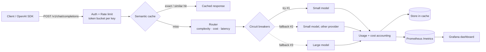

# LLM Gateway

**An OpenAI-compatible gateway that routes each request to the right model, survives provider outages, caches answers semantically, and tracks every token and dollar.**

Point any OpenAI SDK at it by changing one URL. Behind that URL, the gateway decides which model should answer, falls back automatically when a provider fails, serves repeated questions from cache, enforces per-key rate limits, and exports Prometheus metrics to a Grafana dashboard.


```python
from openai import OpenAI
client = OpenAI(base_url="http://localhost:8000/v1", api_key="sk-demo-dev")
client.chat.completions.create(model="auto", messages=[{"role": "user", "content": "Explain TCP vs UDP"}])
```

---

## Why

Apps that call LLMs directly run into the same problems:

| Problem | What the gateway does |
|---|---|
| A provider goes down, so your app goes down | Fallback chain + per-model **circuit breakers** |
| Every prompt goes to the expensive model | **Complexity-based routing**: easy prompts go to cheap models, hard ones to strong models |
| The same questions get paid for again and again | **Two-layer cache**: exact match plus a semantic (embedding) match |
| One noisy client burns the budget | Per-key **token-bucket rate limiting** and cost accounting |
| No idea what anything costs or how slow it is | **Prometheus metrics** + a pre-built **Grafana dashboard** |

## Architecture



**Request pipeline** (`gateway/service.py`):

1. **Auth and rate limit.** Bearer API keys, a token bucket per key, and `429 + Retry-After` when a key goes over its limit.
2. **Cache lookup.** First an O(1) exact match on the normalized prompt. If that misses, a cosine-similarity search over prompt embeddings, gated by a threshold. Partitioned by model; skipped for high-temperature requests.
3. **Route.** Produce an ordered list of candidate models (strategies below), skipping any whose circuit is open.
4. **Call with fallback.** Try candidates in order. A failure records against that model's circuit breaker and the next candidate is tried. For streaming, fallback happens *before the first token*, so a client never sees half an answer from a failed provider.
5. **Account.** Tokens, cost, latency and fallbacks go to Prometheus and the per-key usage ledger.

### Routing strategies

| Strategy | How it orders candidates |
|---|---|
| `complexity` (default) | Scores the prompt 0–1 from length, reasoning keywords ("step by step", "prove", "debug"…), code blocks and conversation depth. ≥ threshold → large tier first, otherwise small tier. Within a tier, cheapest first. |
| `cost` | Cheapest model first |
| `latency` | Lowest observed EWMA latency first (adapts as providers slow down) |
| explicit model | The requested model first, then same-tier fallbacks, then the other tier |

### Circuit breaker

`CLOSED → OPEN` after N consecutive failures (the model is skipped entirely). After a cooldown it moves to `HALF_OPEN` and lets **one** trial request through: success → `CLOSED`, failure → `OPEN` again.

### Semantic cache: design notes

- The default embedder is a **dependency-free hashing embedder** (word unigrams/bigrams + character trigrams, signed-hashed into 256 dimensions). It catches rewordings with shared vocabulary ("What's a hash map?" vs "Can you explain a hash map?") without a model download or an API call. For true paraphrases ("car" vs "automobile"), implement the `Embedder` protocol with a neural model.
- **Numeric guard:** a semantic hit is only allowed if both prompts contain exactly the same numbers. Embeddings blur `17 * 23` vs `17 * 24`, but the answers are different.
- Vectors live in one contiguous NumPy matrix per partition, so a lookup is a single matrix-vector product. Deleted rows are zeroed and reused.
- TTL expiry plus LRU eviction at `max_entries`.

---

## Results

All numbers below were measured with the scripts in `bench/` and `evals/` (raw JSON in `docs/`). Reproduce them with `make bench-cache`, `make bench-outage` and `python bench/overhead.py`.

### 1. Gateway overhead (`bench/overhead.py`)

Latency the gateway itself adds, measured with a zero-latency provider and 10,000 entries already in the cache:

| Path | p50 | p95 | p99 |
|---|---|---|---|
| Cache miss (full pipeline: auth → cache search → route → call → account → metrics) | **1.7 ms** | 2.3 ms | 3.2 ms |
| Cache hit | **0.64 ms** | 0.83 ms | 1.6 ms |

**Optimization story:** the first version used 1024-dimension embeddings, and a cache miss cost **4.2 ms** p50, mostly scanning the vector matrix. Benchmarking dimensions 128–1024 showed the same hit rate and **zero** false hits at 256 dimensions. Switching cut miss-path overhead **2.4×** (4.2 → 1.7 ms) with no quality loss.

### 2. Cache effectiveness (`bench/cache_benchmark.py`)

10,000 synthetic requests: 200 question intents, each in several phrasings, with Zipf-distributed popularity. **40% of requests are one-off long-tail prompts** that can never hit, so the best possible hit rate is about 60%.

| Threshold | Hit rate | Wrong answers served | Precision |
|---|---|---|---|
| exact-match only | 54.6% | 0 | 100% |
| 0.95 | 56.4% | 0 | 100% |
| **0.92 (default)** | **57.0%** | **0** | **100%** |
| 0.85 | 57.0% | 17 | 99.7% |
| 0.80 | 57.3% | 173 | 97.0% |

Takeaways: the cache avoided **57% of upstream calls** on this workload. The semantic layer adds hits on top of exact matching with **no** wrong answers at 0.92. Below about 0.85 the cache starts serving answers to *different* questions. The default threshold was picked from this sweep.

### 3. Outage simulation (`bench/outage_sim.py`)

20 concurrent clients, unique prompts (so the cache can't hide anything), three 10-second phases. In the middle phase the primary provider fails **100%** of calls.

| Phase | Requests | Success rate | Served by |
|---|---|---|---|
| Baseline | 3,454 | 100% | primary (alpha-mini) |
| **Primary provider down** | 1,530 | **100%** | fallback (beta-mini) |
| Recovery | 2,123 | 100% | back to primary after the half-open trial |

**7,107 requests, zero client-visible errors.** After 3 failures the circuit opened, so the dead provider stopped receiving traffic. After the cooldown, one trial request confirmed recovery and traffic moved back automatically.

### 4. Routing quality vs cost (`evals/run_eval.py`)

30-question dataset (15 easy factual, 15 multi-step reasoning). The complexity router sends **29/30** prompts to the intended tier. The one miss (`h14`) is kept in the dataset on purpose instead of tuning the heuristic to it.

<!-- EVAL_RESULTS_START -->

Measured on **2026-10-14** with real Groq models, 30 prompts, temperature 0, cache bypassed. Raw results: [`docs/eval_groq.json`](docs/eval_groq.json).

| Setup | Accuracy | Easy | Hard | Cost (USD) | p50 latency | Errors |
|---|---|---|---|---|---|---|
| `auto` (smart routing) | **100.0%** | 100.0% | 100.0% | $0.00449 | 744 ms | 0 |
| always `openai/gpt-oss-120b` | **100.0%** | 100.0% | 100.0% | $0.00464 | 797 ms | 0 |

**Smart routing cost 3% less than always using the large model, keeping 100% of its accuracy** (100.0% vs 100.0%).

`auto` traffic split: 16 → `openai/gpt-oss-20b`, 14 → `openai/gpt-oss-120b`. 29/30 prompts went to the intended tier.

**Where the cost goes:**

| Prompt type | Smart routing | Always large | Saving |
|---|---|---|---|
| Simple (15) | $0.00028 | $0.00062 | **55%** |
| Multi-step reasoning (15) | $0.00421 | $0.00401 | ~0% (mostly the same model; -5% is run-to-run answer-length noise) |

Routing cut the cost of simple prompts by **55%** with 15/15 still correct. But on the same model a reasoning answer costs about **6×** a simple one, so reasoning prompts were 94% of spend and the overall saving depends on traffic mix. Projected saving: 3% at 50% simple traffic (this eval), 18% at 80%, 40% at 95%.

Caveat: 30 prompts is a small eval, so treat these as directional numbers.

<!-- EVAL_RESULTS_END -->

---

## Quick start

```bash
# 1. Run locally (mock providers, no API keys needed)
pip install -e ".[dev]"
python -m gateway                    # http://localhost:8000/docs for Swagger UI

# 2. Try it
curl localhost:8000/v1/chat/completions \
  -H "Authorization: Bearer sk-demo-dev" -H "Content-Type: application/json" \
  -d '{"model":"auto","messages":[{"role":"user","content":"What is the capital of France?"}]}' -i
# Look at the headers: X-Gateway-Model, X-Cache, X-Route-Reason, X-Complexity-Score, X-Attempts

# 3. Full stack with Prometheus + Grafana
docker compose up --build
# Grafana: http://localhost:3000  ->  "LLM Gateway" dashboard

# 4. Real providers
cp .env.example .env   # add keys
GATEWAY_CONFIG=config.real.yaml python -m gateway

# 5. Verify everything end to end on macOS (Docker build, full stack, real Groq eval)
./scripts/verify_mac.sh
```

### Endpoints

| Method | Path | Description |
|---|---|---|
| POST | `/v1/chat/completions` | OpenAI-compatible, streaming (`"stream": true`) supported. `model: "auto"` lets the router choose. Header `X-Cache-Bypass: 1` skips the cache; `X-No-Fallback: 1` pins the request to one model (used by evals so a rate-limited model isn't silently swapped). |
| GET | `/v1/models` | Available models |
| GET | `/health` | Healthy vs total models |
| GET | `/metrics` | Prometheus metrics |
| GET | `/admin/usage` | Per-key requests, tokens, cost, cache savings *(admin)* |
| GET | `/admin/providers` | Circuit state, failures, EWMA latency per model *(admin)* |
| POST | `/admin/providers/{name}/chaos` | Fault injection for mock providers: `{"failure_rate": 1.0, "latency_ms": 500}` *(admin)* |

### Supported providers

- **OpenAI-compatible** (`type: openai`): OpenAI, Groq, Together, Fireworks, Ollama, vLLM, LM Studio
- **Anthropic** (`type: anthropic`): Messages API, with system prompt and streaming translated to/from the OpenAI format
- **Mock** (`type: mock`): configurable latency and failure rate, for development, tests and chaos experiments

## Project layout

```
gateway/
  app.py              HTTP layer: endpoints, auth, rate limiting, errors
  service.py          Request pipeline: cache → route → fallback → account
  router.py           Routing strategies + complexity scoring
  circuit_breaker.py  CLOSED / OPEN / HALF_OPEN state machine
  cache.py            Exact + semantic cache, hashing embedder, vector index
  ratelimit.py        Token bucket per API key
  usage.py            Cost accounting
  metrics.py          Prometheus metrics
  providers/          openai_compat.py, anthropic.py, mock.py
tests/                42 tests: API, streaming, fallback, circuits, cache, providers (~93% coverage)
bench/                overhead.py, cache_benchmark.py, outage_sim.py, loadtest.py
evals/                Routing quality-vs-cost harness + dataset
deploy/               Prometheus config, Grafana dashboard
```

## Testing

```bash
make test     # pytest + coverage
make lint     # ruff
```

Provider adapters are tested against fake upstream servers (`httpx.MockTransport`), so the suite needs no network or API keys. CI runs lint and tests on Python 3.11 and 3.12, builds the Docker image and smoke-tests it.

## Known limitations and roadmap

These are deliberate scope cuts. Each one is a good next step:

- [ ] **Redis-backed rate limiter and cache.** Both are in-memory today, so they work per instance. Scaling horizontally needs shared state (Lua script for an atomic token bucket; RedisVL or pgvector for vectors).
- [ ] **Neural embeddings** (e.g. `bge-small` via ONNX) for real paraphrase detection, then rerun the threshold sweep.
- [ ] **ANN index** (HNSW / FAISS) once the cache grows past about 100k entries. The linear scan is fine below that.
- [ ] **Learned router.** Replace the keyword heuristic with a small classifier trained on eval results (which prompts the cheap model actually got right).
- [ ] **Persistent usage ledger** in PostgreSQL, plus per-key monthly budgets.
- [ ] **Tool/function calling** passthrough.
- [ ] **OpenTelemetry tracing** across gateway → provider spans.

## License

MIT
